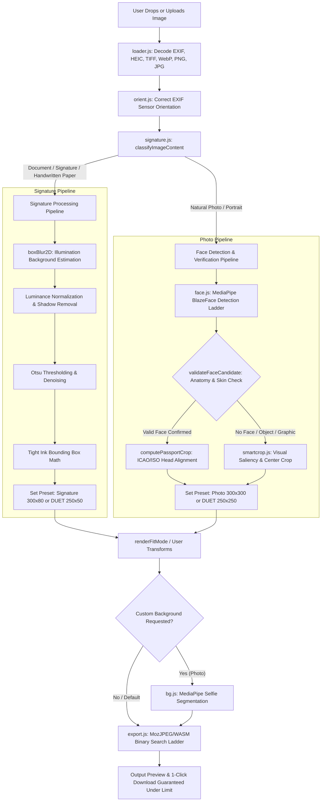

# SnapSignFit — Intelligent Photo & Signature Auto-Formatter
> **100% Free, Privacy-First, Zero-Server Client-Side Media Processor**

[](LICENSE)
[](https://developer.mozilla.org/en-US/docs/Web/Progressive_web_apps)
[]()
[]()

---

## Overview

**SnapSignFit** is a high-performance web tool built to solve strict government application, university admission, and passport portal photo/signature requirements (including **Bangladesh BCS, Teletalk, DUET, Bank Recruitment, SSC/HSC, US Visa DS-160, and International Passports**).

Instead of struggling with complex desktop editors to obtain exact **300×300 px (under 99 KB)** photos or **300×80 px (under 60 KB)** signatures, SnapSignFit performs all necessary adjustments **automatically in milliseconds** directly inside your browser.

> **Privacy Guarantee**: Photos and signatures never leave your device. All neural networks, computer vision algorithms, and compression pipelines execute entirely inside local browser memory via WebAssembly and WebGPU/WebGL.

---

## Key Features

- **Dual-Engine Auto-Detection**: Automatically classifies whether an uploaded file is a portrait photo or a pen signature / handwriting document.
- **1-Click Official Presets**: Pre-configured with official guidelines for Bangladesh Government (BCS/Teletalk), DUET Admission (250×250 & 250×50), Passports (35×45 mm, 2×2 in), and Social Media.
- **3-Step Manual Editor**: Professional-grade studio supporting Crop, Straighten ($\pm 180^\circ$ at $0.1^\circ$ precision), and Eraser/Restore Brush.
- **Adaptive Signature Contrast & Whitening**: Eliminates camera shadows and uneven yellow lighting, converting paper into pure crisp white while keeping ink strokes sharp.
- **AI Background Replacer**: Seamlessly swaps portrait backgrounds to Pure White, Soft Light Blue, Light Gray, Red, or Custom Colors.
- **Guaranteed File-Size Ladder**: Binary-search MozJPEG/WebP compression ladder guarantees files always strictly meet the $\le 99\text{ KB}$ or $\le 60\text{ KB}$ limit without visible artifacting.
- **Bilingual (English & Bengali)**: Full internationalization with automatic Bengali script and numeral support.
- **Offline PWA**: Installable as a progressive web app that works anywhere without an internet connection.

---

## System Architecture: Engine Coordination

When an image is dropped into SnapSignFit, it flows through a sequential computer vision and neural inference pipeline:



---

## Core Scripts & Technology Breakdown

Every file in the `js/` directory has a dedicated, single-responsibility role designed for speed and accuracy:

| File | Purpose & Responsibilities | Core Technologies |
| :--- | :--- | :--- |
| [`js/app.js`](./js/app.js) | **Main Orchestrator & Reactive State Machine**: Manages file lifecycle, DOM events, UI feedback chips, preset selection, zoom/pan synchronizers, and guarantee ladder triggers. | Vanilla ES6 JavaScript |
| [`js/signature.js`](./js/signature.js) | **Signature & Document Computer Vision Engine**: Features `classifyImageContent()` (Hasler-Süsstrunk color entropy & skin metric), separable `boxBlur2D` illumination correction, Otsu thresholding, and `extractSignatureMask()` for brush isolation. | Pure JavaScript / HTML5 Canvas API |
| [`js/face.js`](./js/face.js) | **Biometric Face Detection & Anatomy Validator**: Loads MediaPipe BlazeFace with GPU/CPU fallback, multi-pass retry ladder ($0^\circ, 90^\circ, 180^\circ, 270^\circ$, scaled), and strict `validateFaceCandidate()` to reject handwriting and false positives. | MediaPipe Tasks Vision (WASM/TFLite) |
| [`js/bg.js`](./js/bg.js) | **AI Background Segmentation & Colorizer**: Loads MediaPipe Selfie Segmenter to isolate human portraits and blend edges cleanly against solid white, blue, gray, red, or custom backdrops. | MediaPipe Image Segmenter WASM |
| [`js/editor.js`](./js/editor.js) | **3-Step Manual Photo Editor**: Full Photoshop-style editing modal supporting (1) Aspect-locked bounding crop, (2) Sub-degree rotation & fine straighten with checkered canvas, and (3) Eraser/Restore Brush with smart AI Auto Remove. | HTML5 Canvas 2D Context |
| [`js/editor-pan.js`](./js/editor-pan.js) | **Gestures, Pan & Zoom Subsystem**: Handles high-DPI canvas coordinates, multi-touch pinch-to-zoom, mouse wheel zooming, and edge clamping. | Pointer Events API |
| [`js/export.js`](./js/export.js) | **Export Engine & Size Guarantee**: Employs a binary search ladder over JPEG/WebP compression to guarantee output files never exceed target maximums (e.g. $\le 99\text{ KB}$ or $\le 60\text{ KB}$). | JSquash MozJPEG WASM / WebP / UPNG |
| [`js/loader.js`](./js/loader.js) | **Multi-Format Image Loader & Resizer**: Decodes standard images plus iPhone HEIC/HEIF and TIFF files, applying memory-safe step-down canvas downscaling. | heic2any / UTIF.js / OffscreenCanvas |
| [`js/orient.js`](./js/orient.js) | **EXIF Orientation Parser**: Reads raw JPEG metadata tags (TIFF headers 0x0112) to auto-correct images rotated by camera orientation sensors. | DataView Binary Buffer Parsing |
| [`js/smartcrop.js`](./js/smartcrop.js) | **Visual Saliency & Fallback Cropper**: Content-aware visual salience fallback for non-face images using Laplacian edge-energy and rule-of-thirds composition. | Image Edge Convolution |
| [`js/presets.js`](./js/presets.js) | **Presets Catalog**: Catalog of dimensions, byte limits, crop aspect ratios, and notes for Government, DUET, Exam, Passport, and Social presets. | Structured JSON Constants |
| [`js/session.js`](./js/session.js) | **Offline State & Session Cache**: Automatically saves and restores working canvases and user edits across browser reloads using IndexedDB and localStorage. | IndexedDB API / LocalStorage |
| [`js/i18n.js`](./js/i18n.js) | **Internationalization Engine**: Dual-language engine (English & Bengali) with localized numeral formatting (`০, ১, ২...`) and contextual warnings. | Intl API / DOM Mutation |
| [`sw.js`](./sw.js) | **PWA Offline Service Worker**: Cache-first service worker ensuring instant loading and full offline capability anywhere. | Service Worker API / Cache Storage |

---

## How to Use SnapSignFit

### Step 1: Upload Your Image
Drag and drop your file or click the upload area. Supported formats: **JPEG, PNG, WebP, AVIF, HEIC (iPhone photos), TIFF, and BMP**.

### Step 2: Automatic Classification & Smart Fit
- **Signature / Handwritten Document**: SnapSignFit detects paper luminance and stroke lines, selects **Signature 300×80** (or DUET 250×50), flattens paper lighting, and sharpens ink contrast.
- **Portrait Photo**: SnapSignFit detects facial landmarks, selects **Photo 300×300**, centers the head following official ICAO passport framing, and applies automatic level enhancement.

### Step 3: Manual Adjustments (Optional)
Click **Manual Adjust** to enter the 3-step studio:
1. **Crop**: Resize and reposition the bounding box (aspect ratio is strictly locked to your chosen preset).
2. **Straighten**: Rotate by $90^\circ$ steps or fine-tune tilt with $0.1^\circ$ precision.
3. **Brush / Background**: Use **Auto AI Remove** to isolate the foreground, or paint with **Erase / Restore** brushes.

### Step 4: 1-Click Export
Click **Download Formatted File**. Your image is saved with the exact required pixel dimensions and strictly guaranteed to be under the byte limit (e.g. $\le 99\text{ KB}$).

---

## Third-Party Open Source Credits & Acknowledgements

SnapSignFit utilizes the following permissive open-source libraries for offline, client-side execution:

| Library / Tool | Author / Maintainers | License | Role in SnapSignFit |
| :--- | :--- | :--- | :--- |
| **[MediaPipe Vision Tasks](https://developers.google.com/mediapipe)** | Google LLC | Apache-2.0 | High-speed on-device BlazeFace detection & Selfie image segmentation. |
| **[MozJPEG (jSquash)](https://github.com/jamsinclair/jSquash)** | James Sinclair, Google LLC | BSD-3-Clause | WebAssembly-compiled MozJPEG encoder for maximum quality at tiny file sizes. |
| **[Lucide Icons](https://lucide.dev)** | Lucide Contributors | ISC | Clean, lightweight UI vector icons. |
| **[UPNG.js](https://github.com/photopea/UPNG.js)** | Ivan Kuckir (Photopea) | MIT | Ultra-fast PNG quantization and compression. |
| **[UTIF.js](https://github.com/photopea/UTIF.js)** | Ivan Kuckir (Photopea) | MIT | Fast client-side decoding of TIFF images. |
| **[heic2any](https://github.com/alexcorvi/heic2any)** | Alex Corvi | MIT | In-browser conversion of Apple iPhone HEIC/HEIF photos to readable canvases. |
| **[Pako](https://github.com/nodeca/pako)** | Vitaly Puzrin, Andrei Tuputcyn | MIT | High-performance DEFLATE/zlib compression stream utilities. |

---

## Local Development Setup

To run SnapSignFit locally:

1. **Clone the repository**:
   ```bash
   git clone https://github.com/humayunk45423/SnapSignFit.git
   cd SnapSignFit
   ```

2. **Start a local static server**:
   ```bash
   # Using Node.js
   npx serve .
   
   # Or using Python 3
   python -m http.server 8080
   ```

3. **Open in browser**:
   Navigate to `http://localhost:8080` in Chrome, Edge, Safari, or Firefox.

---

## License

This project is licensed under the [MIT License](./LICENSE). All third-party libraries retain their original permissive open-source licenses detailed in [`THIRD-PARTY-LICENSES.md`](./THIRD-PARTY-LICENSES.md).
