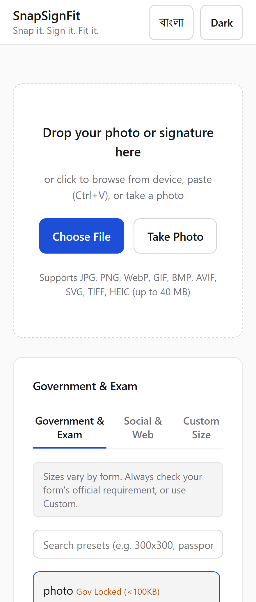
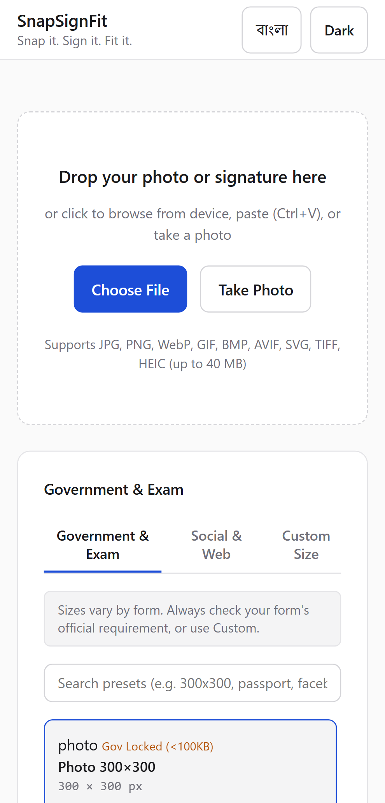
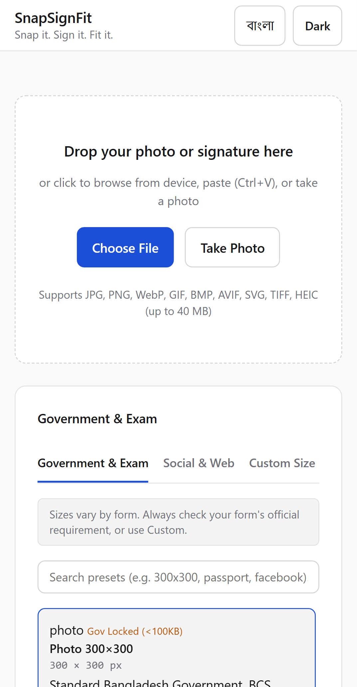
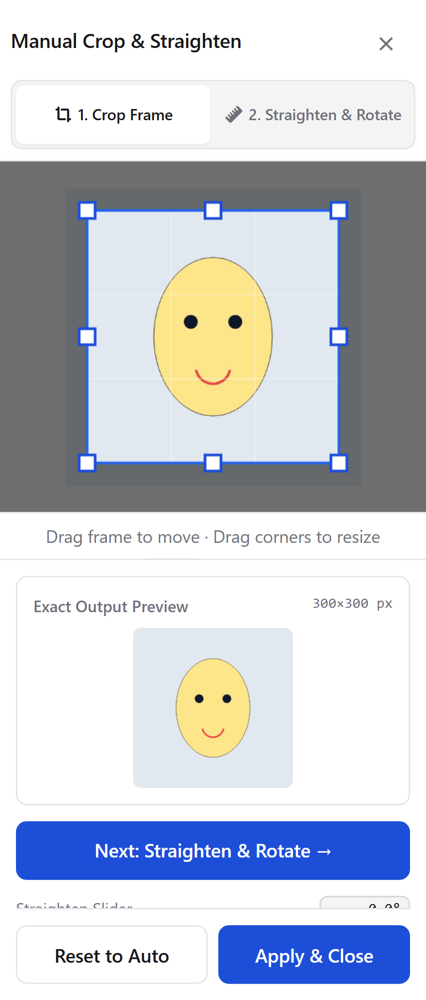
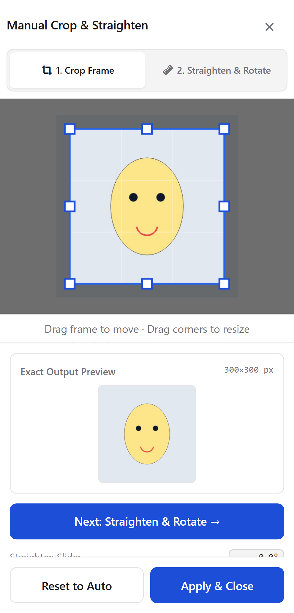
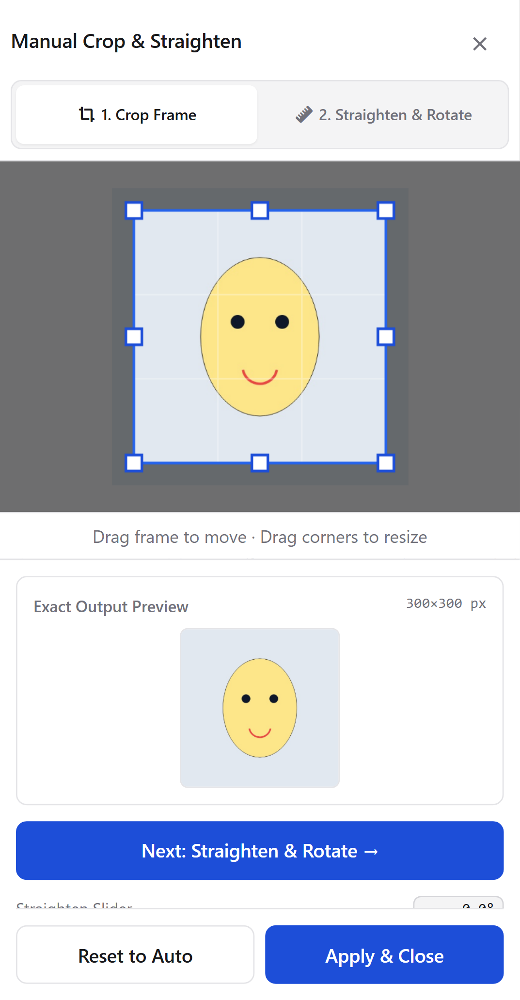
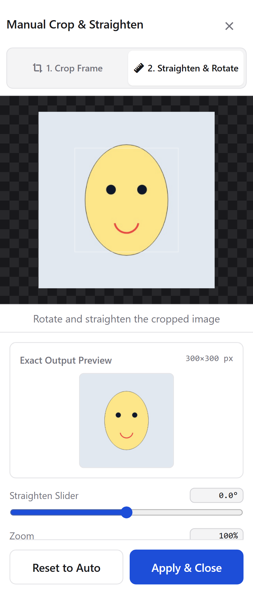
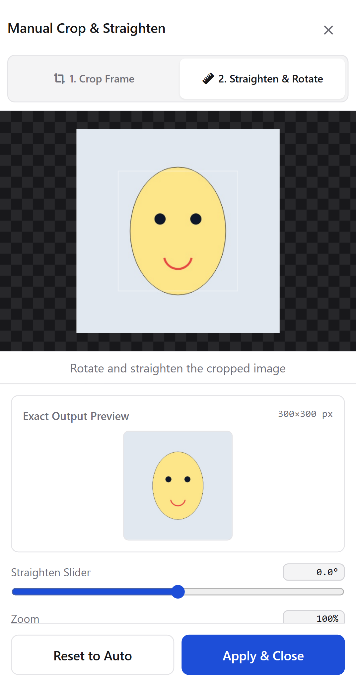

# M-Test Visual Report — SnapSignFit Mobile Layout (M0-M3)

Generated: 2026-09-29 · All 42 tests passed

---

## Summary

| Test | Result |
|------|--------|
| T7: No horizontal overflow at 320/360/390/768/1440px (editor open on both tabs) | ✅ PASS |
| M-Test: Letter-wrap detector — no character-stacked text in editor modal | ✅ PASS |
| M-Test: Both panels visible and stacked on mobile | ✅ PASS |
| M-Test: Close button does not overlap tab bar | ✅ PASS |
| M-Test: Zero scrollWidth overflow at 320/360/390px | ✅ PASS |

---

## Main View — Both Panels Stacked (M0)

Both "Original & Detection" and "Exact Output Preview" panels appear stacked in normal document flow, with correct card styling, proportional heights, and no trapped inner scroll.

### 320px

### 360px

### 390px

---

## Editor Modal — Step 1 (Crop Frame)

Helper caption rendered as ≤2 horizontal lines below canvas. Close button pinned top-right. Tab bar full-width and unobstructed.

### 320px

### 360px

### 390px

---

## Editor Modal — Step 2 (Straighten & Rotate)

Same layout guarantees as Step 1.

### 320px

### 360px

### 390px

---

## Fixes Applied

### M0 — Mobile Panel Layout
- `.preview-split` set to `flex-direction: column` at ≤860px; both panes always visible
- `min-width: 0; max-width: 100%; overflow: hidden` on `.preview-pane` and `.presets-section`
- Grid track changed from `1fr` → `minmax(0, 1fr)` in `@media (max-width: 860px)` to prevent min-content expansion

### M1 — Helper Text
- `#editorHelpText` moved from `position: absolute` into static block flow below canvas
- `white-space: normal; overflow-wrap: normal; width: 100%` — no more letter stacking
- `.editor-close-btn` isolated in `.editor-header-top` row, 44×44px touch target

### M2 — Overflow Regression
- `overflow-x: hidden` on `html` and `body`
- All major containers have `box-sizing: border-box; min-width: 0; max-width: 100%`
- `scrollWidth ≤ clientWidth` confirmed at 320, 360, 390, 768, 1440px with editor open on both tabs

### M3 — Playwright Tests
- `M-Test` added: letter-wrap detector, panel visibility/stacking check, overlap check, overflow check at 320/360/390px
- T7 extended: verifies overflow with editor open on `#tabStep1` and `#tabStep2`
- Screenshots saved to `tests/screenshots/`
